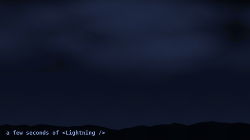
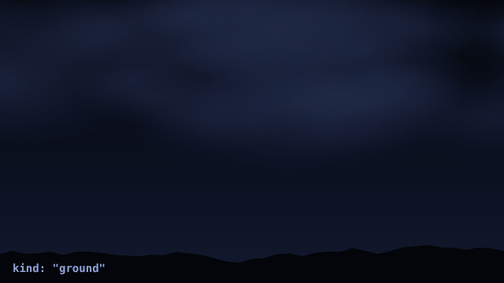
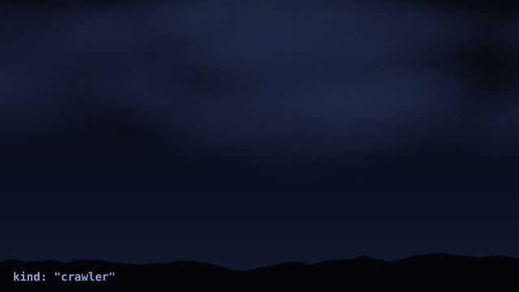
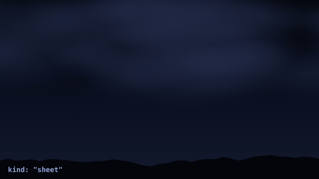
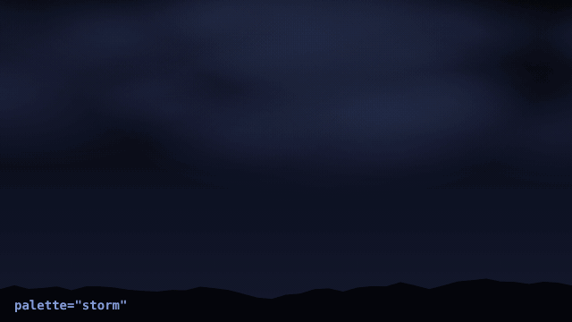
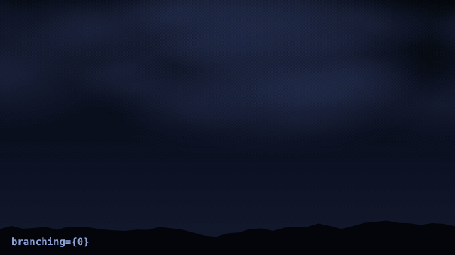

# ⚡ lightning-overlay

Procedural, physically inspired lightning for hero sections and full-page backgrounds. Pure Canvas 2D: no images, no WebGL, and no runtime dependencies beyond React. The React component is optional, because the core engine is framework-free.



## Features

- **Three strike types** with distinct behaviour and sound: cloud-to-ground, crawling cloud-to-cloud, and hidden sheet lightning.
- **Realistic details**: stepped leaders, climbing return strokes, dart-leader restrikes, branching, wind ribboning, chromatic fringe, and clouds lit from within. Every strike is generated fresh.
- **Thunder** through Web Audio, delayed and filtered by simulated distance.
- **Highly customisable**: simple props for common needs, plus deep per-strike config.
- **Lightweight**: no work at all while idle, hidden, or scrolled out of view.
- **Accessible and SSR-safe**: honours `prefers-reduced-motion`, ready for the Next.js App Router.
- **Reproducible** with an optional `seed`.

## Installation

```bash
npm i lightning-overlay
```

Requires React 18 or newer. TypeScript types are included. `motion` is optional and only needed for the scroll example below.

## Quick start

`<Lightning />` fills its nearest positioned ancestor, so give the parent `position: relative`.

```tsx
import Lightning from "lightning-overlay";

export function Hero() {
  return (
    <section style={{ position: "relative", height: "100vh", background: "#000" }}>
      <Lightning />
      <h1 style={{ position: "relative", zIndex: 40 }}>Storm warning</h1>
    </section>
  );
}
```

### Scroll-linked visibility

`visibility` accepts a number, a getter, or any object with `.get()`, so a Motion `MotionValue` works directly without re-rendering React. Near `0`, strikes stop being built and drawn.

```tsx
"use client";
import { useRef } from "react";
import { useScroll, useTransform } from "motion/react";
import Lightning from "lightning-overlay";

export function Hero() {
  const ref = useRef<HTMLElement>(null);
  const { scrollYProgress } = useScroll({ target: ref, offset: ["start start", "end start"] });
  const visibility = useTransform(scrollYProgress, [0, 0.6], [1, 0]);

  return (
    <section ref={ref} style={{ position: "relative", height: "200vh", background: "#000" }}>
      <div style={{ position: "sticky", top: 0, height: "100vh", overflow: "hidden" }}>
        <Lightning visibility={visibility} palette="violet" interval={[2, 7]} />
      </div>
    </section>
  );
}
```

## Strike types

Each strike is one of three types, picked by weighted random (see `weights`).

| Type | Description |
| --- | --- |
| `ground` | A stepped leader reaches the ground, the return stroke races back up the channel, and weaker restrikes follow. Branches fork mostly near the bottom and the channel drifts sideways in the wind. Often paired with the heavy thunder clap. |
| `crawler` | A horizontal cloud-to-cloud discharge growing in both directions, with many short branches and a shimmer of soft pulses. Sometimes drops a leg out of the cloud base. |
| `sheet` | No visible channel. The bolt is hidden in the cloud deck and only the sky and clouds flicker. Quiet, distant, atmospheric. |





## Props

All props are optional. Changing a prop never restarts the storm; the new value is picked up by the next strike or frame.

### Component

| Prop | Type | Default | Description |
| --- | --- | --- | --- |
| `visibility` | `number \| () => number \| { get(): number }` | `1` | Master visibility, 0 to 1. |
| `volume` | `number` | `0.7` | Thunder volume. Shortcut for `sound.volume`. |
| `muted` | `boolean` | `false` | Silence thunder, keep visuals. Shortcut for `sound.muted`. |
| `respectReducedMotion` | `boolean` | `true` | Render nothing when the visitor prefers reduced motion. |
| `className` | `string` | – | Applied to both canvases. |
| `style` | `CSSProperties` | – | Merged over the default canvas styles. |
| `boltZIndex` | `number` | `29` | Stacking order of the channel canvas. |
| `glowZIndex` | `number` | `31` | Stacking order of the sky-glow canvas. |
| `onStrike` | `(info: { kind, time }) => void` | – | Called whenever a strike fires. |
| `ref` | `Ref<LightningHandle>` | – | See [Imperative API](#imperative-api). |

### Timing

| Option | Type | Default | Description |
| --- | --- | --- | --- |
| `interval` | `[min, max]` seconds | `[1.5, 6.5]` | Time between strikes. |
| `firstStrikeDelay` | seconds | `1.2` | Delay before the first strike. |
| `doubleStrikeChance` | `0–1` | `0.2` | Chance of a quick second strike. |
| `doubleStrikeDelay` | `[min, max]` ms | `[80, 220]` | Delay of that second strike. |
| `weights` | `{ ground, crawler, sheet }` | `{ 40, 28, 32 }` | Relative frequency per type. `0` disables a type. Partial objects are fine. |
| `seed` | `number \| null` | `null` | Fixed seed for a reproducible storm. |
| `paused` | `boolean` | `false` | Stop scheduling new strikes. Running ones finish. |

### Appearance

| Option | Type | Default | Description |
| --- | --- | --- | --- |
| `palette` | `PaletteName \| Partial<Record<PaletteKey, Color>>` | `"storm"` | Preset or custom colours. See [Palettes](#palettes). |
| `intensity` | `number` | `1` | Global brightness multiplier. |
| `thickness` | `number` | `1` | Channel thickness multiplier. |
| `glow` | `number` | `1` | Halo around the channel. `0` disables it. |
| `flash` | `number` | `1` | Sky and cloud illumination. `0` disables it. |
| `branching` | `number` | `1` | Branch chance and count. `0` gives clean bolts, `2.5` very branchy ones. |
| `wind` | `number` | `1` | Sideways drift between restrikes. `0` disables it. |
| `flicker` | `number` | `0.1` | Per-frame flicker amplitude. `0` is steady. |
| `fringe` | `boolean` | `true` | Subtle chromatic fringe on the main channel. |
| `fringeColors` | `[Color, Color]` | `[[255,90,120],[70,120,255]]` | Fringe colours. |

`Color` is `[r, g, b]`, `"#rgb"`, `"#rrggbb"`, `"rgb(…)"` or `"rgba(…)"`.

### Performance

| Option | Type | Default | Description |
| --- | --- | --- | --- |
| `quality` | `"auto" \| "high" \| "medium" \| "low"` | `"auto"` | `auto` starts at `high` and steps down on slow devices. |
| `maxDpr` | `number` | `2` | Cap for `devicePixelRatio`. |
| `render.glowResolution` | `number \| null` | `null` | Sky-glow canvas resolution (0–1). `null` follows `quality`. |

| Quality | DPR cap | Glow resolution | Halo spacing | Fringe | Widest stroke pass |
| --- | --- | --- | --- | --- | --- |
| `high` | 2 | 0.5 | 1× | on | on |
| `medium` | 1.5 | 0.5 | 1.5× | on | on |
| `low` | 1 | 0.35 | 2.2× | off | skipped |

### Advanced: `render`

| Option | Default | Description |
| --- | --- | --- |
| `render.passes` | 5 passes, 34 px to 1.3 px | Layered strokes `{ width, alpha, color: "outer" \| "mid" \| "inner" \| "core" }`, widest first. |
| `render.frontMs` | `55` | Time for a ground return stroke to climb the channel. |
| `render.bloomRadius` | `150` | Halo radius in px around a ground channel. |

### Advanced: per-type config

Ranges are `[min, max]`. Pass only what you want to change, for example `ground={{ restrikes: [4, 8] }}`.

**`ground`**

| Key | Default | Description |
| --- | --- | --- |
| `leaderMs` | `[130, 190]` | Time the leader takes to reach the ground. |
| `returnDelayMs` | `35` | Gap between leader arrival and return stroke. |
| `returnDecayMs` | `70` | Decay time of the main return stroke. |
| `restrikes` | `[2, 5]` | Number of restrikes (upper bound exclusive). |
| `restrikeGapMs` / `restrikeAmp` / `restrikeDecayMs` | `[45,130]` / `[0.45,0.95]` / `[35,75]` | Spacing, strength and decay of restrikes. |
| `endY` | `[0.72, 0.95]` | Landing height as a fraction of container height. |
| `spread` | `0.95` | Sky-bloom radius relative to the larger container side. |
| `impact` | `1` | Glow strength at the touch-down point. |
| `leaderGlow` | `0.28` | Brightness of the leader before the return stroke. |
| `afterglow` | `0.2` | Lingering glow of the channel. |
| `attackMs` | `4` | Rise time of each pulse. Higher is softer. |
| `clouds` | `5` | Number of lit cloud blobs. |
| `branch` | – | Branching behaviour (see below). |

**`crawler`** shares `leaderMs` (`[110,200]`), `returnDelayMs` (`30`), `spread` (`0.75`), `impact` (`0.5`), `leaderGlow` (`0.3`), `afterglow` (`0.22`), `attackMs` (`6`), `clouds` (`6`) and `branch` with `ground`, and adds:

| Key | Default | Description |
| --- | --- | --- |
| `flickers` | `[3, 8]` | Number of shimmering follow-up pulses. |
| `flickerGapMs` / `flickerAmp` | `[35,110]` / `[0.3,0.8]` | Spacing and strength of those pulses. |
| `dropChance` | `0.3` | Chance of a leg dropping out of the cloud base. |

**`sheet`**

| Key | Default | Description |
| --- | --- | --- |
| `pulses` | `[2, 6]` | Number of irregular flashes. |
| `gapMs` / `amp` / `decayMs` | `[50,170]` / `[0.3,0.75]` / `[45,110]` | Spacing, strength and decay of flashes. |
| `spread` / `afterglow` / `attackMs` / `clouds` | `0.7` / `0.08` / `14` / `6` | As for `ground`. |

**`branch`** (used by `ground.branch` and `crawler.branch`)

| Key | Ground / Crawler default | Description |
| --- | --- | --- |
| `c1`, `m1` | `0.055, 8` / `0.07, 11` | Fork chance per point and maximum number of branches. |
| `c2`, `m2` | `0.03, 2` / `0.035, 3` | The same for sub-branches. |
| `up`, `drop` | `0, 0` / `0.25, 0.35` | Chance a branch heads upward or hangs straight down. |
| `angle` | `[0.35,1.0]` / `[0.3,1.1]` | Fork angle range in radians. |
| `len` | `[0.05,0.2]` / `[0.04,0.16]` | Branch length as a fraction of container height. |
| `low` | `true` / `false` | Favour forks toward the bottom of the channel. |

## Palettes

Pass a preset name, or override individual colours. Anything you omit keeps the default look.

```tsx
<Lightning palette="ember" />
<Lightning palette={{ outer: "#ff4fd8", flash: "#ff7be5", cloud: [200, 70, 190] }} />
```



| Preset | Look |
| --- | --- |
| `storm` | Default pale blue-white, like a long-exposure photograph. |
| `violet` | Purple-white. |
| `ember` | Orange-white. |
| `toxic` | Green-white. |
| `mono` | Neutral grey-white. |

Palette keys: `outer` (wide halo), `mid` (ionised air), `inner` (hot plasma), `core` (blown-out centre), `flash` (sky illumination), `cloud` (light scattered in clouds). Presets are defined in [`src/config/palettes.ts`](https://github.com/Rigel6306/lightning-overlay/blob/main/src/config/palettes.ts).

## Recipes



```tsx
{/* Subtle ambient flicker behind content */}
<Lightning intensity={0.6} interval={[4, 10]} weights={{ ground: 0, crawler: 20, sheet: 80 }} muted />

{/* Violent storm */}
<Lightning
  interval={[0.8, 3]}
  doubleStrikeChance={0.45}
  branching={1.8}
  thickness={1.3}
  ground={{ restrikes: [4, 8], restrikeGapMs: [30, 90] }}
/>

{/* Clean, minimal bolts */}
<Lightning branching={0} fringe={false} weights={{ ground: 100, crawler: 0, sheet: 0 }} />

{/* Low-end devices */}
<Lightning quality="low" maxDpr={1} />

{/* Same storm on every page load */}
<Lightning seed={42} />

{/* React to strikes (UI flash, analytics, haptics) */}
<Lightning onStrike={({ kind }) => console.log("strike:", kind)} />
```

## Imperative API

```tsx
import { useRef } from "react";
import Lightning, { type LightningHandle } from "lightning-overlay";

const storm = useRef<LightningHandle>(null);

<Lightning ref={storm} />
<button onClick={() => storm.current?.strike("ground")}>Smite</button>
```

| Member | Description |
| --- | --- |
| `strike(kind?)` | Fire a strike now. `kind` is `"ground"`, `"crawler"` or `"sheet"`; random if omitted. |
| `pause()` / `resume()` | Stop or restart the automatic storm, independent of the `paused` prop. |
| `engine` | The underlying `LightningEngine`, or `null` while unmounted or under reduced motion. |

## Using the engine without React

`LightningEngine` takes two canvases and has no dependencies. Give the glow canvas `mix-blend-mode: screen`.

```ts
import { LightningEngine } from "lightning-overlay";

const engine = new LightningEngine({
  bolt: document.querySelector("#bolt")!, // channels and halo
  glow: document.querySelector("#glow")!, // sky and cloud illumination
  visibility: 1,
  options: { palette: "violet", seed: 7 },
  onStrike: (info) => console.log(info.kind),
});

engine.start();                        // automatic storm
engine.fire("ground");                 // or fire one by hand
engine.setOptions({ intensity: 0.8 }); // live update, no restart
engine.pause();
engine.resume();
engine.dispose();                      // clears timers, observers and audio
```

**Manual mode** (`manual: true`) disables timers, the animation loop and audio. You call `fire(kind, now)` and `render(now)` yourself, which is useful for tests and deterministic frames:

```ts
const engine = new LightningEngine({ bolt, glow, manual: true, options: { seed: 1 } });
engine.fire("ground", 0);
for (let t = 0; t < 1200; t += 20) engine.render(t);
```

## Sound

Thunder uses short audio samples played through Web Audio. Each strike type behaves as if it were a different distance away: ground bolts are close and loud, crawlers are further, and sheet lightning is a distant, muffled rumble.

The package does not bundle audio files. Put your own in your public directory; the defaults are:

```
public/sounds/heavyThunder.mp3
public/sounds/thunder1.mp3
public/sounds/thunder2.mp3
```

Missing files are skipped silently. To use other files or tune the sound:

```tsx
<Lightning
  sound={{
    volume: 0.7,                 // 0–1, same as the `volume` prop
    muted: false,                // same as the `muted` prop
    heavyUrl: "/sounds/heavyThunder.mp3", // null = never use a heavy clap
    lightUrls: ["/sounds/thunder1.mp3", "/sounds/thunder2.mp3"],
    boost: 2.5,                  // loudness after per-strike gain; a compressor prevents clipping
    maxConcurrent: 3,            // overlapping voices
    playbackRate: [0.92, 1.06],  // random pitch variation per clap
    minVisibility: 0.15,         // below this visibility there is no thunder
    delayScale: 1,               // 0 = instant, 2 = twice as far away
    distance: {
      ground:  { delay: [0.05, 0.25], gain: 1,    lowpass: 16000, heavy: 0.45 },
      crawler: { delay: [0.2, 0.6],   gain: 0.85, lowpass: 8000,  heavy: 0.12 },
      sheet:   { delay: [0.5, 1.2],   gain: 0.6,  lowpass: 3500,  heavy: 0 },
    },
  }}
/>
```

Browsers block audio until the visitor interacts with the page. Audio is therefore set up lazily on the first gesture, and strikes before that stay silent rather than queueing up. There is no thunder while the tab is hidden or the component is scrolled out of view, and muted or zero volume costs nothing.

## How it stays fast

- **Idle means free.** The animation loop only runs while a strike is animating, so a quiet storm uses no per-frame CPU.
- **Hidden means skipped.** No strikes are built or drawn when the tab is hidden or `visibility` is near zero.
- **Stable engine.** The engine is created once. Prop changes are applied in place and rebuild only what changed, so the storm and audio are never restarted.
- **Cheap sky glow.** The sky and cloud layer holds only soft gradients, so it renders at reduced resolution (0.5×, or 0.35× on `low`) and is scaled up by CSS.
- **Cached gradients.** Gradients are drawn once into small sprites and reused with `drawImage`, instead of being created every frame.
- **Even halo stamping.** The halo is stamped by arc length rather than per point, so over-draw does not depend on how jagged a bolt is.
- **Fewer path builds.** Each path segment is built once and stroked for every pass, and invisible passes are skipped.
- **Low garbage.** Channels are flat typed arrays read through reusable scratch buffers, finished strikes are removed in place, and colours are precomputed strings.
- **Adaptive quality.** With `quality: "auto"`, the engine steps `high → medium → low` if frames average slower than about 25 fps. It never steps back up.
- **Capped work.** Resolution is capped by `maxDpr`, and no more than 8 strikes can be active at once.
- **Lazy audio.** The audio context is created after the first user gesture, files load on demand, and failed loads are not retried.

## Accessibility

When the visitor prefers reduced motion, `<Lightning />` renders nothing. Set `respectReducedMotion={false}` to override this. The canvases are `aria-hidden` and ignore pointer events.